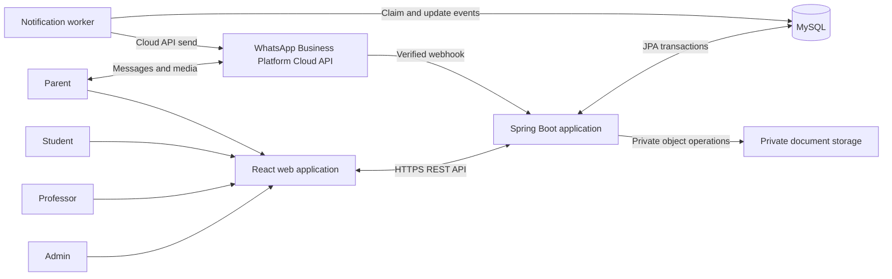

# CollegeConnect

## Phase 2 — System Architecture and Logical ER Model

**Document version:** 1.1  
**Status:** Approved Phase 2 design baseline; college policy decisions remain open  
**Requirements baseline:** [CollegeConnect SRS v1.3](./CollegeConnect_SRS_v1.3.md)  
**Scope:** Architecture and logical data relationships only. This document does not create database scripts, application entities, APIs, or source code.

**Version 1.1 changes:** Clarifies the WhatsApp outbox lifecycle, attendance correction concurrency and history, and CIE/SEE mark revisions and post-publication handling.

---

## 1. Purpose and design principles

This document translates the approved requirements into a proposed system structure and a normalized logical data model. It is intended to explain how the major parts communicate and how the main records relate before implementation begins.

The design follows these principles:

1. Keep attendance and academic records authoritative in MySQL.
2. Make authorization depend on both a user's role and the specific records they are allowed to access.
3. Keep the first release as a modular application rather than introducing distributed microservices prematurely.
4. Commit business changes and their notification intent atomically; send WhatsApp messages asynchronously.
5. Preserve history through explicit correction, audit, and deactivation instead of destructive edits.
6. Store uploaded files privately and authorize every download.
7. Leave college policy choices open where the SRS identifies an Open Decision (OD).

## 2. System context

CollegeConnect has four human roles: Admin, Professor, Student, and Parent. Staff and student users primarily use the React web application. Parents can use the optional web dashboard or complete parent tasks using WhatsApp without a dashboard login.



The diagram is a logical view, not a deployment prescription. The notification worker may run in the same deployable as the API initially, provided it runs independently of the attendance HTTP request. It can be scaled separately if notification volume later requires it.

## 3. Proposed application architecture

### 3.1 Architecture style

Use a **modular monolith with layered backend responsibilities** for the initial release:

- The frontend is a React single-page application using React Router for navigation and Axios for API calls.
- The backend is a Java Spring Boot REST application using Spring Security, JWT authentication, Spring Data JPA, and validated DTOs.
- MySQL is the transactional system of record.
- A background notification processor reads committed outbox records and integrates with the official WhatsApp Business Platform Cloud API.
- Supporting files are stored in private file/object storage; MySQL stores their metadata and case association, not the file bytes by default.

This is simpler to develop and operate than microservices while retaining clear module boundaries. Modules can be split into separate services later only if scale, ownership, or operational needs justify that change.

### 3.2 Logical backend layers

| Layer / module | Responsibility |
| --- | --- |
| `controller` | REST and webhook endpoints; parse requests and return response DTOs. Controllers do not contain business rules or expose JPA entities. |
| `dto` and `validation` | Request/response types and input validation, including field and cross-field rules. |
| `service` | Use-case orchestration and business rules: attendance submit, parent access checks, leave decisions, marks publishing, and correction authorization. |
| `repository` | Database queries and persistence through Spring Data JPA. Queries should enforce the requested scope where practical. |
| `entity` | Persistence model for the logical records in Section 6. |
| `security` and `config` | Authentication, JWT handling, role/resource authorization, CORS, webhook configuration, and application wiring. |
| `integration.whatsapp` | WhatsApp Cloud API client, template selection, media retrieval, inbound message parsing, webhook verification, and provider status mapping. |
| `integration.storage` | Private document storage operations and safe retrieval. |
| `notification` | Outbox event creation, concurrency-safe claiming, attempts, retries, reconciliation, and delivery status processing. |
| `exception` | Consistent error mapping for API clients; no internal stack traces or provider secrets returned to users. |
| `audit` | Append-only records of sensitive actions, including attendance corrections, relationship changes, publication, and manual notification actions. |

These are logical responsibilities, not a mandatory Java package tree. A later implementation plan may group related packages while preserving the boundaries.

### 3.3 Frontend responsibilities

The React application provides role-specific navigation and forms. It may hide actions a role cannot perform for usability, but the backend remains the authorization authority.

- Admin screens: academic setup, account/link management, reports, audit, and notification operations.
- Professor screens: assigned sessions and rosters, attendance marking, authorized leave/absence review, and assigned marks.
- Student screens: the student's own attendance, requests, and published marks.
- Parent screens: linked-child attendance, leave and absence status, documents, preferences, and published marks.

The parent web experience is optional for parents. It does not replace or reduce the WhatsApp capabilities required by the SRS.

### 3.4 Security boundaries

1. Web clients communicate with the API over HTTPS outside local development.
2. Spring Security authenticates web/API requests and applies role and resource-level checks. A valid JWT alone does not grant access to arbitrary student records.
3. Student queries are restricted to the authenticated student; parent queries require an active verified parent-child link; professor queries require an assigned offering/session; Admin access is institution-wide and audited.
4. WhatsApp webhook requests are verified using the provider's signature verification mechanism before processing. Webhook verification secrets and API credentials are external configuration, not source-controlled values.
5. File downloads pass through an authorization check for the linked student and case. A public or merely hard-to-guess URL is not sufficient access control.
6. Passwords are one-way hashed. Sensitive tokens and credentials are kept in deployment secrets/configuration.

## 4. Important application flows

### 4.1 Attendance submission and parent notification

1. The professor authenticates and requests an assigned, open class session.
2. The API checks the professor's assignment and returns the session roster.
3. The professor submits one status for each roster student.
4. The service validates the full roster, session state, and duplicate-submit rules.
5. In one MySQL transaction, the application records attendance, creates/reuses absence cases as appropriate, changes the session to submitted, and inserts the corresponding notification outbox events.
6. If the transaction fails, no partial attendance submission or corresponding send intent is committed.
7. After commit, a worker claims eligible events and sends through the WhatsApp adapter. WhatsApp latency or outage does not block or undo the attendance transaction.
8. Provider message IDs and delivery callbacks update notification history. Known successful events are not automatically sent again; ambiguous outcomes follow reconciliation before another send, as required by the SRS.

### 4.2 Attendance correction

1. An authorized Admin or professor opens a submitted record within the policy-defined scope and correction window (SRS OD-COR-WHO / OD-COR-WINDOW).
2. The service rechecks authorization and the record's current status. The submitted request includes the expected current status/version so a concurrent correction cannot silently overwrite a newer change.
3. The actor enters the replacement status and a mandatory reason. The original submitter and original submitted-at value remain unchanged.
4. In one transaction, the service verifies the expected current version, updates the current attendance status, appends an immutable correction row containing the before/after values and actor details, updates related absence-case state, and creates any required WhatsApp outbox events.
5. If the expected version no longer matches, the operation is rejected as a conflict; the user reloads the latest record and decides whether another correction is appropriate.
6. A later reversal is a new correction with its own reason and history row. Existing correction rows are never edited or deleted during normal operation.

The allowed actors and correction time window remain college decisions; this workflow does not grant professors permission beyond the SRS rules.

### 4.3 CIE/SEE mark entry, amendment, and publication

1. An authorized user enters a mark against the correct student and assessment. Draft values are validated against the assessment's configured grading rules and are not visible to students or parents.
2. A mark change appends a history row with the prior value (if any), new value, actor, timestamp, revision number, and reason. A correction does not erase the earlier mark.
3. An authorized publisher explicitly publishes a marks batch. In one transaction, publication state/history is recorded and parent notification outbox events are created for eligible linked parents.
4. **Proposed handling of a change after publication:** preserve the previously published revision as the visible version while the amendment is reviewed; publish the amended revision only through an explicit authorized republish action. The current mark points to both its current revision and last published revision, so parent/student queries continue to read the published revision until republish. Republish is audited and creates new notification events. This avoids silently changing a result parents have already seen.
5. The college must approve or change this proposed post-publication visibility rule and decide whether amendment reasons, reviewer approval, or a correction window are mandatory. These choices do not change the requirement to retain mark history.

### 4.4 Parent WhatsApp interaction

1. The provider sends an inbound event to the webhook endpoint.
2. The endpoint verifies the webhook and records/deduplicates the provider event before dispatching it.
3. The integration resolves the verified sender number to an active parent account and its active child links.
4. If the parent has multiple linked children and the request is not specific enough, the interaction asks the parent to select a child.
5. A use-case service checks scope and interprets the requested task (attendance, published marks, leave, absence explanation, status, preferences, or document flow).
6. Business changes are persisted through the same services used by the web application. A leave request is recorded as pending/submitted, never automatically approved.
7. The response is sent through the WhatsApp adapter under current template/session-window rules. No information is disclosed for unregistered or unlinked numbers.

### 4.5 Document upload and retrieval

1. An upload arrives through an authorized web session or a verified WhatsApp media flow.
2. The service resolves the active student and the specific leave request or absence case; ambiguous uploads require the parent to select a destination.
3. The application validates configured file type/size policy and stores the bytes in private storage.
4. MySQL stores document metadata and a foreign-key association to exactly one owner record.
5. A later download rechecks the caller's role and access to the owning case. The application does not expose storage credentials or public file paths.

### 4.6 WhatsApp outbox lifecycle

The lifecycle below makes a distinction between the **business event**, each **send attempt**, and the provider's **delivery status**. The event status is persisted in MySQL; the worker's in-memory queue is not the source of truth.

| Event state | Meaning and permitted next step |
| --- | --- |
| `PENDING` | Committed send intent, not yet claimed. A worker may atomically claim it. |
| `PROCESSING` | Claimed under a time-limited lease by one worker. A second worker must not send it concurrently. |
| `SENT` | The provider accepted the request and its message ID was persisted. This does not mean delivered. Never automatically send this event again. |
| `DELIVERED` | Provider callback confirms delivery; a later read callback may add read information without creating another event. |
| `FAILED_RETRYABLE` | Provider definitively did not accept the attempt and the error may be retried. Retry the same event with a new attempt after backoff. |
| `FAILED_DEAD_LETTER` | Provider definitively rejected the request permanently or the automatic retry limit was reached. Admin review is required. |
| `AMBIGUOUS_DELIVERY` | The provider may have accepted the send, but acceptance cannot yet be confirmed. Suppress sends while reconciling callbacks/correlation. |
| `SKIPPED_NO_OPTIN` / `SKIPPED_PREFERENCE` | No provider call was made because eligibility/preferences disallowed sending. |
| `CANCELLED` | Event was cancelled before a send attempt, for an audited business reason. It is not a way to erase an already accepted message. |

Expected transitions:

```text
PENDING -> PROCESSING
PROCESSING -> SENT -> DELIVERED
PROCESSING -> FAILED_RETRYABLE -> PROCESSING
PROCESSING -> FAILED_DEAD_LETTER
PROCESSING -> AMBIGUOUS_DELIVERY -> SENT or DELIVERED (if reconciliation confirms acceptance)
PROCESSING -> AMBIGUOUS_DELIVERY -> FAILED_RETRYABLE (only if never-accepted is confirmed)
PROCESSING -> SKIPPED_NO_OPTIN | SKIPPED_PREFERENCE
PENDING -> SKIPPED_NO_OPTIN | SKIPPED_PREFERENCE | CANCELLED
FAILED_DEAD_LETTER -> PROCESSING (Admin-authorized, only after confirmed non-acceptance)
```

Additional lifecycle rules:

1. A definite provider rejection with no accepted message can be retried on the same event, using a new attempt number and the same idempotency key. A timeout, worker crash, or missing provider ID alone does not prove rejection; classify it as ambiguous.
2. `SENT` means accepted by the Cloud API. Delivery status is tracked separately on attempts: `PENDING`, `DELIVERED`, `READ`, or `FAILED`. A provider delivery failure after acceptance leaves the event `SENT`; it is not a never-accepted send and is not automatically repeated.
3. Verified callbacks update delivery status idempotently and must not regress a more advanced known state because callbacks arrive late or out of order. `READ` implies delivered. Callbacks update existing attempts and never create a new send.
4. An event in `FAILED_DEAD_LETTER` may be retried only after Admin confirms the provider never accepted it; this appends an attempt to the same event and is audited. If acceptance is known, explicit resend requires a new linked event and a new idempotency key.
5. An ambiguous event is not retried until reconciliation confirms the message was never accepted. An Admin-authorized send while still ambiguous is an exceptional, audited residual-duplication-risk action, as specified by the SRS.
6. On worker restart, expired `PROCESSING` leases with a known provider ID resume callback/status reconciliation; those without an ID become `AMBIGUOUS_DELIVERY`, not `PENDING`.
7. Lease expiry, retry limits, backoff, and whether certain categories may be cancelled are configuration/policy details; they must not weaken the no-blind-retry rule.

## 5. Logical ER model

### 5.1 Modeling conventions

- The diagram describes logical entities and relationships, not final column types or migration DDL.
- `PK` means primary key; `FK` means foreign key; `UK` means a uniqueness constraint.
- Account credentials and role-specific profile information are separated. A profile belongs to one account; the approved SRS treats role permissions per account and leaves dual-role accounts unresolved.
- Percentages and summaries are derived from class-wise attendance. They should not be treated as independent source-of-truth values unless a later performance requirement justifies a cache.
- College-specific policy values and workflow choices remain the SRS's Open Decisions.

### 5.2 ER diagram

```mermaid
erDiagram
    USER_ACCOUNT {
        bigint account_id PK
        string login_identifier UK
        string password_hash
        string role
        string status
    }
    ADMIN_PROFILE {
        bigint admin_id PK
        bigint account_id FK,UK
        string display_name
    }
    PROFESSOR_PROFILE {
        bigint professor_id PK
        bigint account_id FK,UK
        string employee_identifier UK
        bigint department_id FK
    }
    STUDENT_PROFILE {
        bigint student_id PK
        bigint account_id FK,UK
        string college_identifier UK
        bigint programme_id FK
        bigint section_id FK
        string status
    }
    PARENT_PROFILE {
        bigint parent_id PK
        bigint account_id FK,UK
        string verified_mobile UK
        boolean whatsapp_opt_in
    }
    PARENT_STUDENT_LINK {
        bigint link_id PK
        bigint parent_id FK
        bigint student_id FK
        string verification_status
        datetime activated_at
        datetime revoked_at
    }
    DEPARTMENT {
        bigint department_id PK
        string name UK
    }
    PROGRAMME {
        bigint programme_id PK
        bigint department_id FK
        string name
    }
    ACADEMIC_YEAR {
        bigint academic_year_id PK
        string name UK
        date start_date
        date end_date
    }
    SEMESTER {
        bigint semester_id PK
        bigint academic_year_id FK
        string name
        date start_date
        date end_date
    }
    SECTION {
        bigint section_id PK
        bigint programme_id FK
        bigint semester_id FK
        string name
    }
    SUBJECT {
        bigint subject_id PK
        string code UK
        string name
    }
    SUBJECT_OFFERING {
        bigint offering_id PK
        bigint subject_id FK
        bigint section_id FK
        bigint semester_id FK
        string status
    }
    PROFESSOR_ASSIGNMENT {
        bigint assignment_id PK
        bigint professor_id FK
        bigint offering_id FK
        date valid_from
        date valid_to
    }
    ENROLLMENT {
        bigint enrollment_id PK
        bigint student_id FK
        bigint offering_id FK
        date valid_from
        date valid_to
        string status
    }
    TIMETABLE_SLOT {
        bigint slot_id PK
        bigint assignment_id FK
        string weekday
        time start_time
        time end_time
    }
    CLASS_SESSION {
        bigint session_id PK
        bigint slot_id FK
        bigint assignment_id FK
        bigint substitute_professor_id FK
        date session_date
        time start_time
        time end_time
        string status
    }
    SESSION_ROSTER {
        bigint session_id PK,FK
        bigint student_id PK,FK
    }
    ATTENDANCE_RECORD {
        bigint attendance_id PK
        bigint session_id FK
        bigint student_id FK
        bigint submitted_by_professor_id FK
        string status
        int version
        datetime submitted_at
    }
    ATTENDANCE_CORRECTION {
        bigint correction_id PK
        bigint attendance_id FK
        bigint actor_account_id FK
        int correction_sequence
        string previous_status
        string new_status
        string reason
        datetime created_at
    }
    ABSENCE_CASE {
        bigint absence_case_id PK
        bigint attendance_id FK
        string status
        string explanation
        bigint reviewer_account_id FK
    }
    LEAVE_REQUEST {
        bigint leave_request_id PK
        bigint student_id FK
        bigint requester_account_id FK
        date start_date
        date end_date
        string reason
        string status
        bigint reviewer_account_id FK
    }
    LEAVE_REQUEST_SESSION {
        bigint leave_request_id PK,FK
        bigint session_id PK,FK
    }
    CIE_ASSESSMENT {
        bigint assessment_id PK
        bigint offering_id FK
        string name
        decimal maximum_marks
        string publication_status
    }
    CIE_MARK {
        bigint cie_mark_id PK
        bigint assessment_id FK
        bigint student_id FK
        decimal marks
        int revision_number
        int published_revision_number
    }
    CIE_MARK_HISTORY {
        bigint history_id PK
        bigint cie_mark_id FK
        bigint actor_account_id FK
        int revision_number
        decimal previous_marks
        decimal new_marks
        string reason
        datetime changed_at
    }
    SEE_ASSESSMENT {
        bigint see_assessment_id PK
        bigint offering_id FK
        string name
        string publication_status
    }
    SEE_MARK {
        bigint see_mark_id PK
        bigint see_assessment_id FK
        bigint student_id FK
        decimal marks_or_grade
        int revision_number
        int published_revision_number
    }
    SEE_MARK_HISTORY {
        bigint history_id PK
        bigint see_mark_id FK
        bigint actor_account_id FK
        int revision_number
        string previous_value
        string new_value
        string reason
        datetime changed_at
    }
    SUPPORTING_DOCUMENT {
        bigint document_id PK
        bigint absence_case_id FK
        bigint leave_request_id FK
        bigint uploaded_by_account_id FK
        string private_storage_key UK
        string media_type
        string scan_status
    }
    NOTIFICATION_PREFERENCE {
        bigint preference_id PK
        bigint parent_id FK
        string category
        boolean enabled
    }
    NOTIFICATION_OUTBOX {
        bigint event_id PK
        bigint student_id FK
        bigint parent_id FK
        bigint original_event_id FK
        string source_type
        bigint source_id
        string idempotency_key UK
        string status
        int attempt_count
        datetime next_attempt_at
        datetime lease_until
    }
    NOTIFICATION_ATTEMPT {
        bigint attempt_id PK
        bigint event_id FK
        int attempt_number
        string provider_message_id
        string result
        string delivery_status
    }
    WHATSAPP_WEBHOOK_EVENT {
        bigint webhook_event_id PK
        string provider_event_id UK
        bigint parent_id FK
        bigint attempt_id FK
        string event_type
        datetime received_at
    }
    IN_APP_NOTIFICATION {
        bigint notification_id PK
        bigint recipient_account_id FK
        string source_type
        bigint source_id
        datetime created_at
        datetime read_at
    }
    AUDIT_LOG {
        bigint audit_id PK
        bigint actor_account_id FK
        string action
        string entity_type
        string entity_id
        datetime created_at
    }

    USER_ACCOUNT ||--o| ADMIN_PROFILE : has
    USER_ACCOUNT ||--o| PROFESSOR_PROFILE : has
    USER_ACCOUNT ||--o| STUDENT_PROFILE : has
    USER_ACCOUNT ||--o| PARENT_PROFILE : has
    PARENT_PROFILE ||--o{ PARENT_STUDENT_LINK : linked_by
    STUDENT_PROFILE ||--o{ PARENT_STUDENT_LINK : linked_to
    DEPARTMENT ||--o{ PROGRAMME : contains
    DEPARTMENT ||--o{ PROFESSOR_PROFILE : employs
    PROGRAMME ||--o{ SECTION : organizes
    ACADEMIC_YEAR ||--o{ SEMESTER : contains
    SEMESTER ||--o{ SECTION : schedules
    SUBJECT ||--o{ SUBJECT_OFFERING : offered_as
    SECTION ||--o{ SUBJECT_OFFERING : includes
    SEMESTER ||--o{ SUBJECT_OFFERING : runs_in
    PROFESSOR_PROFILE ||--o{ PROFESSOR_ASSIGNMENT : assigned
    SUBJECT_OFFERING ||--o{ PROFESSOR_ASSIGNMENT : taught_by
    STUDENT_PROFILE ||--o{ ENROLLMENT : enrolls
    SUBJECT_OFFERING ||--o{ ENROLLMENT : has_students
    PROFESSOR_ASSIGNMENT ||--o{ TIMETABLE_SLOT : assigned_to
    TIMETABLE_SLOT o|--o{ CLASS_SESSION : generates
    PROFESSOR_ASSIGNMENT ||--o{ CLASS_SESSION : responsible_assignment
    PROFESSOR_PROFILE o|--o{ CLASS_SESSION : substitutes
    CLASS_SESSION ||--o{ SESSION_ROSTER : snapshots
    STUDENT_PROFILE ||--o{ SESSION_ROSTER : appears_on
    CLASS_SESSION ||--o{ ATTENDANCE_RECORD : records
    STUDENT_PROFILE ||--o{ ATTENDANCE_RECORD : receives
    PROFESSOR_PROFILE ||--o{ ATTENDANCE_RECORD : submitted_by
    ATTENDANCE_RECORD ||--o{ ATTENDANCE_CORRECTION : corrected_by
    USER_ACCOUNT ||--o{ ATTENDANCE_CORRECTION : performs
    ATTENDANCE_RECORD ||--o{ ABSENCE_CASE : may_create
    STUDENT_PROFILE ||--o{ LEAVE_REQUEST : has
    USER_ACCOUNT ||--o{ LEAVE_REQUEST : requests
    LEAVE_REQUEST ||--o{ LEAVE_REQUEST_SESSION : targets
    CLASS_SESSION ||--o{ LEAVE_REQUEST_SESSION : requested_for
    SUBJECT_OFFERING ||--o{ CIE_ASSESSMENT : defines
    CIE_ASSESSMENT ||--o{ CIE_MARK : records
    STUDENT_PROFILE ||--o{ CIE_MARK : receives
    CIE_MARK ||--o{ CIE_MARK_HISTORY : revised_by
    USER_ACCOUNT ||--o{ CIE_MARK_HISTORY : changes
    SUBJECT_OFFERING ||--o{ SEE_ASSESSMENT : defines
    SEE_ASSESSMENT ||--o{ SEE_MARK : records
    STUDENT_PROFILE ||--o{ SEE_MARK : receives
    SEE_MARK ||--o{ SEE_MARK_HISTORY : revised_by
    USER_ACCOUNT ||--o{ SEE_MARK_HISTORY : changes
    ABSENCE_CASE o|--o{ SUPPORTING_DOCUMENT : supported_by
    LEAVE_REQUEST o|--o{ SUPPORTING_DOCUMENT : supported_by
    USER_ACCOUNT ||--o{ SUPPORTING_DOCUMENT : uploads
    USER_ACCOUNT ||--o{ IN_APP_NOTIFICATION : receives
    PARENT_PROFILE ||--o{ NOTIFICATION_PREFERENCE : configures
    STUDENT_PROFILE ||--o{ NOTIFICATION_OUTBOX : concerns
    PARENT_PROFILE ||--o{ NOTIFICATION_OUTBOX : receives
    NOTIFICATION_OUTBOX o|--o{ NOTIFICATION_OUTBOX : resends
    NOTIFICATION_OUTBOX ||--o{ NOTIFICATION_ATTEMPT : attempted
    PARENT_PROFILE o|--o{ WHATSAPP_WEBHOOK_EVENT : sender
    NOTIFICATION_ATTEMPT o|--o{ WHATSAPP_WEBHOOK_EVENT : updates
    USER_ACCOUNT ||--o{ AUDIT_LOG : performs
```



## 6. Entity groups and relationship explanation

### 6.1 Accounts, roles, and parent-child access

- `USER_ACCOUNT` is the authentication identity: login identifier, password hash, account status, and one primary role.
- Each role profile (`ADMIN_PROFILE`, `PROFESSOR_PROFILE`, `STUDENT_PROFILE`, `PARENT_PROFILE`) holds data specific to that role. The account-to-profile relationship is one-to-zero-or-one; the matching role profile is required for an active account of that role.
- `PARENT_STUDENT_LINK` resolves the many-to-many relationship: one parent may be linked to several students, and a student may have multiple parents/guardians. Its verification, activation, and revocation details support access checks and audit history. Access requires an active verified link.
- A verified WhatsApp number belongs to the parent profile, not to an arbitrary child record. A change of number must follow the SRS verification and opt-in requirements.

### 6.2 Academic structure and enrollment

- A `DEPARTMENT` contains programmes and is the academic home for professors.
- A `PROGRAMME` organizes sections. An `ACADEMIC_YEAR` contains semesters; each `SECTION` belongs to the relevant programme and semester.
- `SUBJECT` is the catalog entry. `SUBJECT_OFFERING` is the subject taught for a particular section/term and is the unit to which professors, students, sessions, and CIE assessments are assigned.
- `PROFESSOR_ASSIGNMENT` connects a professor to an offering. A timetable slot uses that assignment. Substitute teaching must be explicitly recorded for the specific session, not inferred from a changed timetable.
- `ENROLLMENT` connects a student to an offering over a validity period. Enrollment history allows the system to determine roster eligibility on a class date.

### 6.3 Timetable, session roster, and attendance

- `TIMETABLE_SLOT` describes a recurring schedule and points to a professor assignment, which identifies the subject offering. `CLASS_SESSION` represents one actual occurrence or an extra session; its assignment identifies the offering without storing a duplicate offering reference. It preserves the time, assignment, and any authorized substitute even if a future timetable changes.
- `SESSION_ROSTER` is a session-specific snapshot of enrolled students. It supports the requirement that attendance is submitted only for the roster belonging to that session and preserves historical roster membership.
- `ATTENDANCE_RECORD` is one student's result in one class session. Enforce uniqueness on `(session_id, student_id)`. A composite foreign key to `SESSION_ROSTER(session_id, student_id)` is recommended so an attendance row cannot be created for someone outside the captured roster.
- Class-wise attendance records are the source for subject and overall percentages; a single daily present/absent value is not a replacement.
- `ATTENDANCE_CORRECTION` appends the previous and new value, actor, time, and mandatory reason. The current record may be updated only as part of this audited correction transaction; history itself is append-only. A version on the current attendance row supports conflict detection for concurrent corrections.
- Each correction receives a sequential revision for its attendance record. Applying a correction checks the expected current value/version in the same transaction, preventing concurrent requests from silently overwriting one another. A reversal is recorded as another correction; it does not delete prior history.
- `ABSENCE_CASE` tracks explanation and review for an absent attendance record. Enforce at most one open absence case for a given attendance record, while allowing closed case history to remain.

### 6.4 Leave, marks, and documents

- `LEAVE_REQUEST` belongs to exactly one student and a requester account. It may cover a date range and/or specific class sessions through `LEAVE_REQUEST_SESSION`. The service must verify that selected sessions belong to the student's offerings. A request remains pending until an authorized reviewer acts.
- `CIE_ASSESSMENT` defines an offering's named component and maximum marks; `CIE_MARK` stores one student's current result per assessment. `SEE_ASSESSMENT` and `SEE_MARK` represent the college-authorized SEE result and its publication state. Only published marks are visible to students and parents.
- `CIE_MARK_HISTORY` and `SEE_MARK_HISTORY` append the initial value and each subsequent amendment with revision number, prior/new value, actor, time, and reason. Current mark rows track both current revision and last published revision. Student/parent reads select the published revision; authorized staff can review the latest draft. History rows are not updated or deleted in normal operation.
- Publication and amendment visibility are separate concepts: publishing makes a validated batch visible; editing a published mark must not silently erase the old value or skip audit. Section 4.3 proposes keeping the last published value visible until an authorized republish.
- `SUPPORTING_DOCUMENT` stores metadata and a private storage key; the file itself is held outside the relational database by default. Exactly one of `absence_case_id` or `leave_request_id` must be populated. This exclusive-owner rule should be enforced with foreign keys plus a database check constraint where supported, and validated by the service as well.

### 6.5 WhatsApp, audit, and notification records

- `NOTIFICATION_PREFERENCE` stores parent choices by message category. If the college chooses per-child settings rather than the SRS default per-parent setting, the model can add an optional parent-child link reference without changing the message workflow.
- `IN_APP_NOTIFICATION` is for staff-facing work queues and alerts (for example, a new leave request for an authorized reviewer). It is distinct from WhatsApp `NOTIFICATION_OUTBOX` events, which record external send intent and delivery attempts.
- `NOTIFICATION_OUTBOX` records the intent to send, associated student and parent, event source, idempotency key, lifecycle status, retry time, and worker lease. An explicit resend is a new event linked to its original and uses a new idempotency key. The business change and initial outbox event commit in one transaction.
- `NOTIFICATION_ATTEMPT` records each provider call, result, error/correlation data, and provider message ID. A known successful send is not automatically repeated. An ambiguous outcome must be reconciled before another send.
- `WHATSAPP_WEBHOOK_EVENT` stores deduplication/correlation data for inbound commands and provider status callbacks, retaining only the data needed under the approved retention policy. A parent association may be absent for unregistered senders; an attempt association may be absent for inbound commands.
- Since notifications can originate from multiple business record types, `source_type`/`source_id` is a logical polymorphic reference in this proposal. It cannot alone be protected by a normal relational foreign key. During physical schema design, prefer a typed source-reference design (for example nullable typed foreign keys with an exactly-one check) if enforceable, or document and rigorously validate the polymorphic relationship in the service and audit checks.
- `AUDIT_LOG` attributes sensitive actions to an account and time. Attendance correction details also live in the dedicated append-only `ATTENDANCE_CORRECTION` history.

## 7. Recommended integrity rules and indexes

The eventual MySQL schema should enforce these rules with primary keys, foreign keys, unique constraints, checks, and transactions where appropriate:

1. Unique account login identifier; unique official student identifier and faculty employee identifier.
2. Unique parent-child pair for a relationship history model, with active/verified status checked for authorization.
3. Unique subject offering for its subject, section, and academic term unless the college explicitly allows parallel offerings.
4. Unique active enrollment for a student/offering and valid enrollment date range.
5. Unique timetable-derived session for a slot/date; extra sessions must have their own distinct identity.
6. Unique session roster membership `(session_id, student_id)` and attendance `(session_id, student_id)`.
7. Unique CIE mark `(assessment_id, student_id)` and SEE mark `(see_assessment_id, student_id)`; each marked student must be eligible for that assessment's offering.
8. Unique mark-history revision `(mark_id, revision_number)` in each history table; history records are append-only. The current revision and published revision pointers must reference existing history revisions.
9. Attendance corrections use a monotonically increasing per-record revision and optimistic concurrency check; a stale expected version cannot overwrite a newer update.
10. At most one open absence case per attendance record; closed case history remains available.
11. Unique outbox idempotency key; unique attempt number `(event_id, attempt_number)`; unique provider webhook event identifier where supplied by the provider. A resend has a distinct event and idempotency key.
12. Supporting document must have exactly one owning case/request; the owner and document must have the same student scope.
13. Restrict deletion of records referenced by attendance, marks, documents, outbox, or audit history. Use status changes, revocation, or cancellation instead of cascading deletion.
14. Index common scope and history queries, including student/date attendance, offering/session date, parent link status, leave status/date, notification status/next-attempt time, and audit actor/time. Index selection should be confirmed against actual queries during implementation.

Percentages and report totals should be calculated from valid records using the documented formula. Do not hard-code an official attendance eligibility threshold before the college resolves the corresponding SRS Open Decision.

## 8. Deployment and operational view

For an initial hosted deployment, use a managed Java application runtime/container, managed MySQL with private network access and backups, HTTPS ingress, and private object storage for documents. Keep WhatsApp credentials and database credentials in the hosting platform's secret manager or equivalent environment configuration.

The API and worker may initially share an application deployment. The worker must nevertheless have independent scheduling/concurrency controls and must claim events safely if more than one application instance is running. Persisted outbox records—not in-memory queues—are the durable source of notification work.

The college must choose a deployment provider, region, backup/restore objectives, retention periods, alerting provider, and service availability target before production. These remain operational decisions; this design does not select a vendor or promise an unapproved SLA.

## 9. Decisions deferred to later design or college policy

This architecture intentionally does not settle the SRS Open Decisions, including:

- Attendance statuses and the official percentage/eligibility formula.
- Leave and absence approvers, deadlines, cancellation, and approved-leave effect on marking.
- CIE scheme, marks publisher, and SEE source/granularity.
- Attendance correction actors, correction window, and visibility of detailed correction history (SRS OD-COR-WHO / OD-COR-WINDOW / OD-COR-FACULTY-VIEW).
- Post-publication mark amendment policy: who may amend, whether a second reviewer is required, amendment reason requirements, and whether the prior published mark stays visible until explicit republish (proposed in Section 4.3).
- Document limits, retention, and malware scanning service.
- Parent dashboard login method, OTP channel, language, and final opt-in procedure.
- Whether a person may hold multiple roles in one account.
- Hosting provider, region, deployment topology, RPO/RTO, and availability target.

Before creating implementation entities or schema migrations, these choices should be reviewed and the logical model translated into physical MySQL constraints and migration scripts.

## 10. Phase 2 completion and approval gate

Phase 2 provides the proposed architecture, application flows, logical ER diagram, entity explanations, and recommended integrity rules. It does **not** implement entities or database tables.

**Next phase after approval:** Phase 3 — backend project setup. Database entity and schema implementation should follow the project's approved sequence and this ER model, after the remaining relevant policy decisions are recorded.
